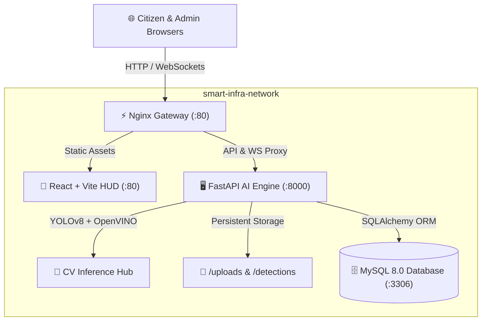

# 📡 Smart-Infra: AI Infrastructure Monitoring System

[](https://www.docker.com/)
[](https://fastapi.tiangolo.com/)
[](https://www.python.org/)
[](https://react.dev/)
[](https://github.com/ultralytics/ultralytics)
[](https://www.mysql.com/)

> [!IMPORTANT]
> **Next-Generation Urban Surveillance & Infrastructure Governance**: Smart-Infra is an enterprise-grade, AI-driven platform for automated road hazard detection, geospatial tracking, public reporting, and municipal work-order dispatch. It fuses YOLOv8 with Intel OpenVINO optimization for high-frame-rate real-time inference on edge and server hardware.

---

## 📑 Table of Contents
- [✨ Key Features](#-key-features)
- [🛠️ Technology Stack](#️-technology-stack)
- [🏛️ System Architecture](#️-system-architecture)
- [🚀 Quick Start (Docker - Recommended)](#-quick-start-docker---recommended)
- [💻 Manual Local Development](#-manual-local-development)
- [🔐 Default Credentials & Ports](#-default-credentials--ports)
- [⚙️ Environment Variables](#️-environment-variables)
- [📊 Model Performance & Benchmarks](#-model-performance--benchmarks)
- [📁 Repository Structure](#-repository-structure)
- [🛡️ Security & Notes](#️-security--notes)

---

## ✨ Key Features

- 🎯 **Real-Time Pothole & Hazard Detection**: Custom-trained YOLOv8 model capable of sub-25ms inference with OpenVINO CPU acceleration.
- 🗺️ **Geospatial Monitoring Map**: Interactive GIS mapping with severity-coded pins, live coordinate tracking, and hazard density heatmaps.
- 📱 **Citizen Reporting & Tracking Portal**: Public interface for citizens to upload damage photos, geotag incidents, and track maintenance progress in real time.
- 👷 **Municipal Admin Console & Work Orders**: Role-based officer portal to triage reports, dispatch field workers, assign tasks, log repair notes, and resolve work orders.
- 🤖 **Urban AI Advisor**: LLM-powered municipal copilot delivering maintenance prioritization, budget estimation, and repair strategy suggestions.
- 📡 **Live Telemetry & WebSocket Streams**: Low-latency bi-directional WebSocket feed broadcasting detection events, live FPS, and road integrity scores directly to the HUD.

---

## 🛠️ Technology Stack

| Domain | Technologies |
| :--- | :--- |
| **AI & Computer Vision** | YOLOv8 (Ultralytics), OpenVINO (Intel CPU Optimized), OpenCV, SciPy (Centroid Tracker), PyTorch |
| **Backend Services** | Python 3.10+, FastAPI, SQLAlchemy ORM, PyMySQL, Pydantic v2, Uvicorn, WebSockets |
| **Database** | MySQL 8.0 (Docker) / SQLite (Fallback) with automatic schema migration |
| **Frontend HUD** | React 18, Vite, TypeScript, Lucide Icons, Leaflet / GIS Maps, Chart.js / Recharts |
| **Proxy & Gateway** | Nginx Alpine (Reverse Proxy, API Gateway, WebSocket Upgrade) |
| **Containerization** | Docker Engine & Docker Compose (Multi-Stage Builds, CPU-Wheel PyTorch Optimization) |

---

## 🏛️ System Architecture



---

## 🚀 Quick Start (Docker - Recommended)

The entire full-stack system—including MySQL 8, the FastAPI AI backend with CPU PyTorch, and the React frontend served by Nginx—launches with a single command:

```powershell
docker compose up --build -d
```

### Accessing Services
- 🖥️ **Command Center & HUD (Frontend):** [http://localhost](http://localhost) (or [http://localhost:5173](http://localhost:5173))
- 📡 **Interactive API Docs (Swagger):** [http://localhost:8000/docs](http://localhost:8000/docs)
- 🗄️ **MySQL Database:** `localhost:3306` (Database: `smart_infra`)

### Inspecting Logs & Managing Containers
```powershell
# View streaming logs across all containers
docker compose logs -f

# Check health and status of services
docker compose ps

# Stop all services gracefully
docker compose down
```

---

## 💻 Manual Local Development

If you prefer running services directly on your host machine without Docker:

### 1. Prerequisites
- Python 3.10 or 3.11
- Node.js 18+ and npm
- Local MySQL server (or SQLite fallback)

### 2. Backend Setup
```powershell
cd backend
python -m venv venv
.\venv\Scripts\activate

# Install dependencies (CPU PyTorch + standard requirements)
pip install torch torchvision --index-url https://download.pytorch.org/whl/cpu
pip install -r requirements.txt

# Start FastAPI server
uvicorn main:app --reload --host 0.0.0.0 --port 8000
```

### 3. Frontend Setup
```powershell
cd frontend
npm install
npm run dev
```
The local Vite development server will be available at `http://localhost:5173`.

---

## 🔐 Authentication & Access Control

Access control and administrative privileges are enforced through secure role-based tokens:

- **Administrative Signup:** Admin registration requires a private verification code configured in your local environment (`ADMIN_SIGNUP_CODE`).
- **Initial Setup:** The deployment administrator defines this code privately before deployment. It is **never** committed to version control.
- **Account Creation:** Users and officers register their own distinct credentials through the application interface during first-time setup.

---

## ⚙️ Environment Variables & Configuration

All secrets and system configurations are kept strictly confidential in `backend/.env` (which is excluded from Git via `.gitignore`). 

To configure your local environment, copy the template:
```powershell
cp backend/.env.example backend/.env
```

| Variable | Description | Required | Recommended Format / Default |
| :--- | :--- | :---: | :--- |
| `DATABASE_URL` | SQLAlchemy connection URI | **Yes** | `mysql+pymysql://<user>:<password>@localhost:3306/smart_infra` |
| `JWT_SECRET` | Secret key for cryptographic JWT signing | **Yes** | Generate with: `openssl rand -hex 32` |
| `ADMIN_SIGNUP_CODE` | Private passphrase required for Admin registration | **Yes** | Long, high-entropy custom secret passphrase |
| `ADMIN_INVITE_TTL_HOURS` | Lifetime for admin invitation tokens (hours) | No | `24` |
| `DETECTION_THRESHOLD` | Confidence threshold for YOLO detection | No | `0.45` (Range: `0.10` - `1.00`) |
| `AI_PROVIDER` | LLM backend for Urban Advisor | No | `GEMINI` or `BYTEZ` |
| `AI_API_KEY` | LLM API Key (stored privately in local `.env`) | Optional | Set locally when using generative AI features |

---

## 📊 Model Performance & Benchmarks

The core YOLOv8 model was custom-trained and evaluated on municipal asphalt damage datasets:

| Metric | Score | Note |
| :--- | :--- | :--- |
| **mAP@50** | `66.50%` | Mean Average Precision at IoU 0.50 |
| **Precision** | `65.92%` | Low false-positive rate on street markings |
| **Recall** | `62.15%` | Robust detection under shadowed conditions |
| **F1-Score** | `~64.00%` | Harmonic balance between precision & recall |
| **Inference Latency** | `~18-28 ms` | OpenVINO CPU mode on Intel Core i5/i7 |

---

## 📁 Repository Structure

```
Smart-Infra/
├── docker-compose.yml          # Multi-container orchestration (DB, API, Web)
├── .dockerignore               # Container build exclusions
├── .gitignore                  # Git exclusions for models, logs, and caches
├── README.md                   # System documentation and setup guide
│
├── backend/                    # Python FastAPI AI Brain
│   ├── ai/                     # YOLOv8 models (.pt, .xml), tracker, and logic
│   ├── detections/             # Saved detection frames and snapshots
│   ├── logs/                   # System and inference logs
│   ├── uploads/                # Citizen-uploaded damage photos
│   ├── database.py             # SQLAlchemy models and connection retry logic
│   ├── main.py                 # REST API endpoints and WebSocket handlers
│   ├── requirements.txt        # Backend Python dependencies
│   └── Dockerfile              # CPU-optimized multi-stage Docker build
│
├── frontend/                   # React + TypeScript Command Center
│   ├── src/
│   │   ├── api/                # API client configuration and endpoints
│   │   ├── components/         # HUD widgets, Map, Admin Console, Advisor
│   │   ├── pages/              # Dashboard, Report Issue, Admin, Login
│   │   └── App.tsx             # Root router and authentication guards
│   ├── nginx.conf              # Production reverse proxy configuration
│   └── Dockerfile              # Vite production build served via Nginx
│
└── scripts/                    # Windows one-click automation launch scripts
```

---

## 🛡️ Security & Privacy Architecture

Smart-Infra implements defense-in-depth protection across all layers:

- **Zero-Secrets Policy:** Real credentials, database passwords, JWT signing keys, and admin signup codes are **never** committed to version control or published in this repository.
- **Local Environment Isolation:** All production secrets reside exclusively in local `backend/.env` files, strictly ignored via [.gitignore](file:///c:/Users/mdadi/OneDrive/Desktop/Smart-Infra/.gitignore).
- **Anti-Brute Force Protection:** Authentication endpoints (`/auth/login` and `/auth/register`) enforce dynamic IP/email rate-limiting with automated lockouts and audit logging to thwart credential stuffing and dictionary attacks.
- **Secure File Upload Pipeline:** Image uploads in citizen reporting feature cryptographic UUID file renaming, strict extension/MIME-type whitelisting (`.jpg`, `.jpeg`, `.png`, `.webp`), and streaming size enforcement (max 10MB) to eliminate Path Traversal and Remote Code Execution (RCE).
- **Admin Verification Gate:** Self-service administrative registration requires a locally verified `ADMIN_SIGNUP_CODE` with placeholder blacklist rejection, or single-use invitation tokens with a 24-hour expiration window.
- **Protected Hardware & Process Feeds:** Camera activation (`/start-camera`, `/stop-camera`) is strictly guarded behind user session authentication and input sanitization to eliminate command injection.
- **HTTP Defense Headers:** Standard security headers (`X-Content-Type-Options: nosniff`, `X-Frame-Options: DENY`, `Referrer-Policy`) protect client sessions from clickjacking, MIME sniffing, and cross-site leaks.
- **Credential Sanitization:** If database connection strings contain special characters (such as `@`), encode them (e.g., `%40`) to maintain URI integrity.

---

*Built with ❤️ for Smarter, Safer Municipal Infrastructure.*
